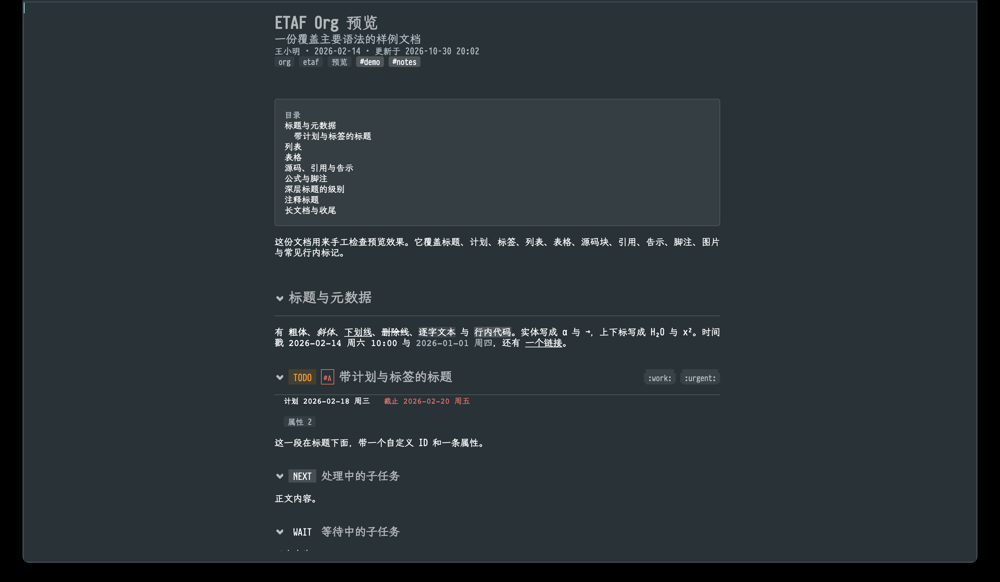

# ETAF Org Preview

ETAF Org Preview renders an Org document as a modern reading view inside
Emacs. It draws the document with [ETAF](https://github.com/emacs-taf/etaf)
components and the [Ebox](https://github.com/emacs-taf/ebox) renderer: a
centered reading measure, a typographic headline scale, keyword and priority
chips, planning lines, tags, nested and description lists, checkboxes,
tables, source and example blocks, quotes, callouts, images, footnotes and a
table of contents.

The preview is read-only and fast on large files. Folding is structural: a
closed section is not rendered at all, so a document opens as an outline and
unfolds on demand. Every displayed value is a reactive source, so a fold, a
reload, a width change or a theme change repaints only what it touches.



## Capabilities

- **Org syntax, not Markdown with stars.** Headlines with keywords, priorities,
  tags, statistics cookies, `COMMENT` and `:ARCHIVE:` markers, planning lines,
  property drawers, `LOGBOOK` clock entries, nested and description lists,
  checkboxes, tables with alignment and width cookies, source, example,
  fixed-width, quote, verse, center, comment and export blocks, callouts
  (`NOTE`, `TIP`, `WARNING`, …), entities, subscripts, timestamps, footnotes,
  citations, macros, targets, links and layout directives. Images honor
  attribute widths, source blocks honor `-n`, and a drawer or logbook keeps its
  text one key away.
- **Structural folding.** Each headline owns a fold cell: `C-c TAB` cycles
  folded, children and open; `C-c f` switches between the outline and the full
  document. A folded subtree is never measured, prepared or mounted.
- **A reading view that follows the source.** Saving the Org file, changing it
  from another program, or typing in its buffer without saving repaints the
  preview after the edit settles and keeps the reader in the same section. A
  publish hands every unchanged block its previous instance, so one edited
  paragraph repaints one paragraph; a 120-section document takes about 27 ms
  from edit to painted page.
- **Formulas and diagrams.** A display formula (`$$…$$`, `\[…\]`, a LaTeX
  environment) is typeset through KaTeX, and a `mermaid` source block is drawn
  through mermaid-cli, each in the page's own colours and cached by source,
  palette and size. Without mermaid-cli both keep their source.
- **Palettes that match the theme.** `auto` derives every surface from the
  active frame's own faces; `dark`, `light` and `sepia` are fixed pages. Chips,
  tables, callouts and rules all read the same semantic colors.
- **Read-only by design.** It never writes the document, runs Babel, evaluates
  `#+TBLFM:` or expands `#+INCLUDE`.

## Requirements

- Emacs 29.1 or newer.
- [ETAF](https://github.com/emacs-taf/etaf) 0.3.0, `etaf-ui` 0.3.3,
  `ebox` and `ecss` (resolved as siblings in this workspace).
- Optional: [mermaid-cli](https://github.com/mermaid-js/mermaid-cli) (`mmdc`)
  draws display formulas and diagrams. Without it both keep their source.
- Org itself is optional. When it is loaded, the preview resolves `id:` links
  and honours `org-todo-keywords`; otherwise it uses the file's own settings.

## Installation

From the ETAF package archive, install `etaf-org-preview`, then:

```elisp
(require 'etaf-org-preview)
```

From a checkout, add this repository and its providers to `load-path` and
byte-compile the package:

```sh
make compile
```

```elisp
(add-to-list 'load-path "~/emacs-taf/etaf-org-preview")
(add-to-list 'load-path "~/emacs-taf/etaf-ui")
(add-to-list 'load-path "~/emacs-taf/etaf")
(add-to-list 'load-path "~/emacs-taf/ebox")
(add-to-list 'load-path "~/emacs-taf/ecss")
(require 'etaf-org-preview)
```

## Usage

`M-x etaf-org-preview-open` renders the Org file at point, or prompts for one.
The preview opens in its own buffer; saving the source repaints it.

| Key | Action |
| --- | --- |
| `C-c TAB` | Fold or unfold the section around point |
| `C-c f` | Switch between the outline and the full document |
| `C-c n` / `C-c p` | Next / previous headline (`n` also works) |
| `C-c j` | Choose a headline |
| `RET` or click | Activate a link, footnote, image; fold a headline |
| `C-c C-o` | Activate the link at point |
| `C-c t` | Show or hide the table of contents |
| `C-c v` | Show or hide comments, properties and metadata |
| `t` | Switch the palette |
| `[` / `]` | Narrow / widen the reading measure |
| `r` | Reload the document |
| `C-c h` | Show the key bindings |
| `q` | Close the preview |

`TAB`, `S-TAB`, `?` and the scroll keys belong to the framework, which is why
folding uses `C-c TAB` and the outline switch uses `C-c f`.

## Scripting

A session works without a buffer, so scripts and tests can render a document
headlessly:

```elisp
(let* ((session (etaf-org-preview-create :file "~/notes.org" :theme 'light))
       (buffer (etaf-mount (generate-new-buffer " *org*")
                           (etaf-org-preview-view session)
                           '(:viewport-width 900 :viewport-height 50))))
  (etaf-org-preview-fold session (nth 2 (car (etaf-org-preview-outline session)))
                        'folded)
  (etaf-org-preview-state session))
```

The root entry's Commentary lists every supported function and variable.

## Documentation

- [User manual](docs/manual.md): workflows, syntax coverage, links, display
  controls, degraded content and recovery.
- [Architecture](docs/architecture.md): modules, data flow, folding, media
  resolution, theming and the measured performance baseline.
- [Changelog](CHANGELOG.md).

## Development

```sh
make compile          # byte-compile with warnings as errors
make test             # public behavior scenarios (tests/acceptance.json)
make check            # structure, compile, acceptance and API boundary gates
make benchmark        # parse, mount, fold and refresh timings
```

`examples/sample.org` is the maintained document every surface should still
show; `examples/etaf-org-preview-demo.el` opens it.
