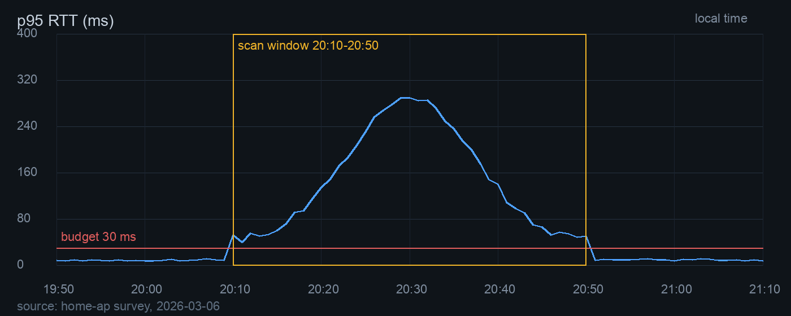

#+TITLE: 一次 Wi-Fi 抖动的复盘
#+SUBTITLE: 从 300 ms 回到 8 ms：一次由信道扫描引发的连锁反应
#+AUTHOR: 家庭网络维护记录
#+DATE: 2026-03-08
#+EMAIL: ops@example.net
#+LANGUAGE: zh
#+KEYWORDS: wifi 802.11 排队 复盘
#+FILETAGS: :network:postmortem:
#+DESCRIPTION: 一次家庭网络抖动的事后分析，记录时间线、测量、假设、处置和遗留问题。
#+OPTIONS: toc:3 todo:t tags:t pri:t ^:t -:t d:nil
#+STARTUP: content
#+TODO: TODO(t) NEXT(n) WAIT(w@) | DONE(d) CANCELLED(c@)
#+PRIORITIES: A C B
#+MACRO: p95 95 分位时延
#+LINK: bug https://tracker.example.net/issues/%s

2026 年 3 月 6 日晚上，家里的视频会议连续卡了四十分钟。路由器日志显示，这段时间 5 GHz 网卡每 90 秒离开当前信道做一次扫描。抖动过去后，同一条链路回到 8 ms。这份记录按时间线、测量、假设、处置和遗留问题整理，方便下一次遇到同类问题时少走弯路[fn::原始日志在 =~/logs/wifi/2026-03-06.log=，抓包文件保留两周。]。

故障期间，这次会话的 {{{p95}}} 从 8 ms 升到 312 ms，重传率从 1.8% 升到 34%。两个数字几乎同时变化，说明问题出在空口，不在上行带宽。下面的分析围绕一个判断展开：扫描让服务能力短暂下降，排队把短暂的中断放大成几十秒的卡顿。

#+BEGIN_CENTER
抖动来自排队，不来自带宽。
#+END_CENTER

* 结论

先给结论，细节放在后面。

1. *扫描是诱因*。网卡离开当前信道时，发不出去的包只能留在队列里。
2. *排队是放大器*。服务能力从 1200 pkt/s 掉到 300 pkt/s，利用率越过 1，队列迅速堆积。
3. *固定信道有效*。把信道钉在 149，关闭自动选信道，扫描不再打断业务。

#+BEGIN_IMPORTANT
真正的问题不是带宽不够，而是扫描期间的空口排队。只升级宽带，抖动不会消失。
#+END_IMPORTANT

#+BEGIN_QUOTE
排队时延在利用率接近 1 时没有上界。工程上的做法不是把带宽加到无限，而是把利用率留在可控范围。
-- 排队论的基本结论
#+END_QUOTE

* DONE 时间线
  CLOSED: [2026-03-08 21:40] DEADLINE: <2026-03-06 周五 23:00>
  :PROPERTIES:
  :OWNER: 我
  :EVIDENCE: 路由器日志、通话端统计、ping 采样
  :END:
  :LOGBOOK:
  - State "DONE" from "NEXT" [2026-03-08 21:40]
  - State "NEXT" from "TODO" [2026-03-06 21:05]
  - Note taken on [2026-03-06 20:58] \\
    先把 ping 采样跑起来，再去翻日志。
  :END:

现场只记了三件事：什么时候开始、什么时候恢复、当时谁在用什么。

#+BEGIN_VERSE
20:10 画面停住
20:12 声音断续
20:41 第六次扫描
20:52 画面恢复
#+END_VERSE

时间点按不同记法整理，方便和后端日志对照。

- <2026-03-06 周五 20:10> 第一次卡顿，会议软件弹出网络不稳提示。
- [2026-03-06 20:12] 通话端记录的重传高峰。
- <2026-03-06 20:10>--<2026-03-06 20:50> 整段抖动，共 40 分钟。
- <2026-03-07 周六 09:00 +1w> 每周复查一次，连续四周。
- <2026-03-20 周五 -3d> 复查提醒提前三天。

#+BEGIN_NOTE
时间戳尽量用带星期和时间的写法。事后对照日志时，星期能帮忙排除夏令时和时区换算的干扰。
#+END_NOTE

* 测量与证据

先量，再猜。下面三段证据分别来自命令、图表和脚本。

** 空口扫描

#+BEGIN_SRC bash
# 连续记录信道切换和扫描事件
iw event -t | grep -E "scan|switch" > /tmp/iw-events.log

# 每分钟采一次往返时延
while true; do
    ping -c 20 -i 0.2 192.168.31.1 | tail -1 >> /tmp/rtt.log
    sleep 60
done
#+END_SRC

** 关键指标

#+CAPTION: 故障前、故障中、修复后的三项指标
#+NAME: tab-metrics
| <l>      | <r>   | <r>   | <r>   |
| 指标     | 故障前 | 故障中 | 修复后 |
|----------+-------+-------+-------|
| p95 时延 |   8 ms | 312 ms |  8 ms |
| 重传率   |  1.8% |   34% |  2.1% |
| 空口利用率 |  41% |   78% |  44% |

** 重传计数

| 时段     | 重传次数 |
|----------+----------|
| 20:00    |       12 |
| 20:10    |      214 |
| 20:20    |      487 |
| 20:30    |      512 |
| 20:40    |      436 |
| 20:50    |       31 |

#+TBLFM: @2$2=vsum(@3..@6)

** 时延曲线

#+CAPTION: 图 1：故障当晚的 p95 时延，扫描窗口内排队时间持续上升
#+NAME: fig-latency

** 采样脚本

#+BEGIN_SRC python :results output
import statistics

samples = [8, 9, 11, 312, 287, 265, 190, 64, 9, 8]

def p95(values):
    ordered = sorted(values)
    index = round(0.95 * (len(ordered) - 1))
    return ordered[index]

print("p50 =", statistics.median(samples), "ms")
print("p95 =", p95(samples), "ms")
#+END_SRC

** 原始输出

#+BEGIN_EXAMPLE
[  5]   0.00-60.00  sec   142 MBytes  19.9 Mbits/sec   0.312 ms   214/120345 (0.18%)
[  5]  60.00-120.00 sec    31 MBytes   4.3 Mbits/sec   1.284 ms  1874/120112 (1.6%)
#+END_EXAMPLE

: $ iperf3 -c 192.168.31.1 -t 60
: Connecting to host 192.168.31.1, port 5201
: [ ID] Interval           Transfer     Bitrate         Retr
: [  5]   0.00-60.00  sec   142 MBytes  19.9 Mbits/sec  214

** 为什么排队会放大

空口是一个单服务台队列。设到达率 $\lambda$，服务率 $\mu$，利用率 $\rho = \lambda / \mu$。平均排队时间为：

\[
W_q = \frac{\rho}{\mu (1 - \rho)}
\]

平时 $\mu = 1200$ pkt/s，$\lambda = 950$ pkt/s，$\rho \approx 0.79$，排队时间约 3 ms。扫描期间 $\mu$ 掉到 300 pkt/s，$\rho \approx 3.17$，队列不再有稳定状态，只能一直涨。

#+BEGIN_WARNING
读数要看清口径。ping 的 95 分位和会议软件自报的卡顿率不是一回事，两个指标只能互相印证，不能直接换算。
#+END_WARNING

* 假设检验

三个候选原因，逐个用证据排除。

- 宽带拥塞 :: 故障时上行只用了 12%，排除。
- 邻居同信道 :: 扫描记录显示信道 36 上有两个强信号，但换到 149 后仍有扫描，排除。
- 周期性扫描 :: 日志里 90 秒一次的扫描与抖动起点对齐，成立。

| 假设         | 证据                     | 判断 |
|--------------+--------------------------+------|
| 宽带拥塞     | 上行峰值 12%             | 排除 |
| 邻居同信道   | 换信道后仍抖动           | 排除 |
| 周期性扫描   | 扫描与抖动起点对齐       | 成立 |

#+BEGIN_TIP
判断原因时先找时间对齐。两条曲线在同一分钟起变化，比十个统计量更有说服力。
#+END_TIP

处置前的检查清单：

- [X] 保存路由器日志和抓包
- [X] 记录故障前后的 p95 和重传率
- [-] 联系宽带运营商
- [ ] 复查扫描间隔

#+BEGIN_CAUTION
自动选信道在密集住宅区很常见。它省事，却会在后台周期性打断业务。关掉之前先确认自己愿意承担固定信道的干扰。
#+END_CAUTION

* 处置 [2/4]

按顺序做，每步都能单独回滚。

1. 登录路由器，把 5 GHz 信道固定为 149。
2. 关闭自动选信道，扫描间隔改为 600 秒。
3. 打开空口公平调度，限制单个客户端的占用。
4. 连续三天采样，确认 p95 回到 10 ms 以内。

| 项目         | 原值     | 新值     |
|--------------+----------+----------|
| 信道         | 自动     | 149      |
| 扫描间隔     | 90 秒    | 600 秒   |
| 空口公平调度 | 关闭     | 开启     |
| 2.4 GHz 频段 | 开启     | 关闭     |

#+BEGIN_SRC shell
# 改完先看配置，再重启无线
uci show wireless | grep -E "channel|scan"
wifi reload
#+END_SRC

工单记录在 [[bug:42][工单 42]]，里面附了这次采样的原始文件。

* NEXT [#A] 复查一周的数据                               :network:measure:
  SCHEDULED: <2026-03-09 周一 10:00> DEADLINE: <2026-03-15 周日 18:00>

复查项写清楚，避免下次只凭感觉判断。

- [ ] 导出 p95 曲线
- [ ] 对比重传率
- [ ] 记录邻居信道变化
- [ ] 把结论补进这份文档

* 长期观测 [3/4]

#+CAPTION: 连续四周的观测结果
| 周次   | p95    | 重传率 | 备注       |
|--------+--------+--------+------------|
| 第 1 周 |  8 ms |  2.1% | 固定信道   |
| 第 2 周 |  9 ms |  1.9% | 无异常     |
| 第 3 周 | 11 ms |  2.4% | 邻居换信道 |
| 第 4 周 |  8 ms |  1.8% | 恢复平稳   |

- 事件记录见 [[id:incident-2026-03-08][这次故障]]。
- 同类文档见 [[file:sample.org][语法样例]]。
- 测量方法见 [[*测量与证据][测量一节]]。

* 遗留问题

还有三件事没弄清。

1. 扫描间隔为什么是 90 秒，固件没有暴露配置项[fn:scan]。
2. 第 3 周的时延抬升与邻居换信道有没有关系[fn:neighbor]。
3. 关闭 2.4 GHz 之后，老设备的兼容性会不会出问题。

扫描行为的背景可以看 [[https://www.rfc-editor.org/rfc/rfc9110][RFC 9110]]，方法与口径参考 [cite:@kurose]。经验公式里，排队时间对利用率很敏感：$\rho$ 从 0.8 升到 0.9，$W_q$ 会翻倍还多。

希腊字母在公式里读起来更顺：$\alpha$、$\beta$、$\lambda$、$\mu$、$\rho$、$\sigma$、$\Delta$、$\Omega$ 分别对应衰减、相位、到达率、服务率、利用率、标准差、增量和总带宽。时延单位写成 10^{-3} 秒比写 ms 更适合放进公式。带宽常用 2^{10} 进制，1 KiB 等于 1024 字节。

#+BEGIN_QUOTE
所有模型都是错的，但有些有用。
-- George Box
#+END_QUOTE

* 附录 A 术语

- 信道扫描 :: 网卡暂时离开工作信道，去其他信道探测，期间无法收发。
- 队列积压 :: 发送队列里等待空口的包，队列越长，时延越高。
- 空口利用率 :: 一段时间内信道被占用的比例，超过 70% 后时延上升很快。
- 重传 :: 接收端没有确认，发送端重发，重传率高说明空口质量差。

* 附录 B 脚本

#+BEGIN_SRC emacs-lisp
(defun my/wifi-p95 (samples)
  "Return the 95th percentile of SAMPLES."
  (let* ((sorted (sort (copy-sequence samples) #'<))
         (index (round (* 0.95 (1- (length sorted))))))
    (nth index sorted)))
#+END_SRC

#+BEGIN_SRC shell
# 一次导出，方便对比
for day in 2026-03-07 2026-03-08 2026-03-09; do
    iw dev wlan0 survey dump > "/tmp/survey-$day.txt"
done
#+END_SRC

#+BEGIN_EXAMPLE
Scan completed :
          Cell 01 - Address: 3C:84:6A:11:22:33
                    Channel:36
                    Frequency:5.18 GHz
                    Quality=42/70  Signal level=-68 dBm
#+END_EXAMPLE

: 这是固定宽度块
: 缩进和空格都会保留

#+BEGIN_COMMENT
这段是给维护者看的备注，默认不显示。
#+END_COMMENT

#+BEGIN_EXPORT latex
\begin{equation}
W_q = \frac{\rho}{\mu (1-\rho)}, \qquad \rho = \frac{\lambda}{\mu}
\end{equation}
#+END_EXPORT

-----

* 附录 C 参考

- 标准：[[https://www.rfc-editor.org/rfc/rfc9110][RFC 9110]]
- 教材：[cite:@kurose]
- 工单：[[bug:42][工单 42]]
- 邮箱：[[mailto:ops@example.net][运维邮箱]]
- 状态页：https://example.net/status

* 附录 D 标题层级

**** 第四级

这一段用来说明第四级标题的缩进和字号。

***** 第五级

第五级标题继续缩小，但仍然能看出层级。

****** 第六级

第六级标题只比正文大一点。

******* 第七级

第七级标题主要靠缩进区分。

******** 第八级

第八级标题已经接近正文，靠缩进和字重辨认。

* COMMENT 未采用的方案

曾经想把扫描间隔改成 30 秒，用更频繁的扫描换取更快的信道切换。实测下来抖动更密，直接放弃。

* 旧版脚本 :ARCHIVE:

#+BEGIN_SRC shell
# 已经废弃的采样脚本，保留作对照
while true; do ping -c 5 192.168.31.1; done
#+END_SRC

[fn:scan] 固件的自动选信道逻辑没有公开文档，只能靠日志推断。

[fn:neighbor] 第 3 周邻居把信道从 36 换到 44，时间与这次抬升吻合，但样本太少。
