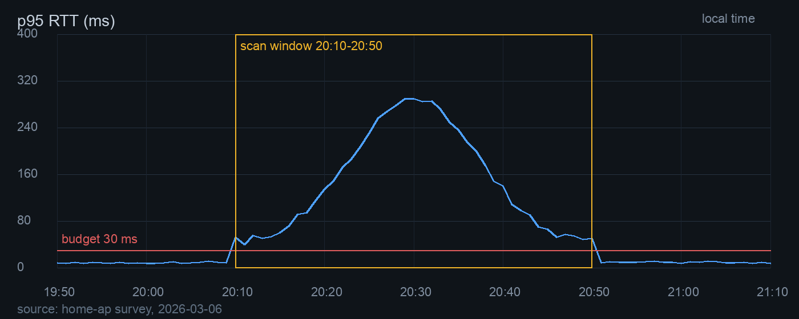

#+TITLE: Org 语法全景
#+SUBTITLE: 一份逐项检查渲染效果的文件
#+AUTHOR: ETAF Org Preview
#+EMAIL: preview@example.net
#+DATE: 2026-11-11
#+LANGUAGE: zh
#+KEYWORDS: org syntax gallery rendering
#+FILETAGS: :gallery:reference:
#+DESCRIPTION: 覆盖预览器支持的 Org 语法和常见变体，用来看每一种写法最终排成什么样。
#+OPTIONS: toc:1 todo:t tags:t pri:t ^:t -:t d:nil
#+STARTUP: content
#+TODO: TODO(t) NEXT(n) WAIT(w@) | DONE(d) CANCELLED(c@)
#+PRIORITIES: A C B
#+MACRO: product ETAF Org Preview
#+LINK: bug https://tracker.example.net/issues/%s
#+TOC: headlines 3

这份文件按类别列出预览器支持的 Org 语法。每一节先写语法名，再放几种常见写法。渲染结果应当和标题描述一致；看不清时可以按 ~C-c v~ 显示隐藏内容。

目录现在只显示一级标题，方便先看到正文。想看两层或三层目录，把文件头的 ~toc:1~ 改成 ~toc:2~ 或 ~toc:3~，重新打开即可。

先把几个键记在这里。~C-c TAB~ 在折叠、只看子标题、全部展开之间切换。~C-c f~ 在整篇大纲和全文之间切换。~C-c v~ 显示注释、属性抽屉、日志和元数据。~t~ 轮换浅色、护眼和深色。~[~ 和 ~]~ 调整阅读宽度。

* 标题、关键词与计划
:PROPERTIES:
:CUSTOM_ID: custom-anchor
:CATEGORY: 语法全景
:END:

标题行可以同时带 TODO 关键词、优先级、标签和统计。下面的子标题分别只放一种，方便对照。

** TODO 待办状态
** NEXT 进行中状态 [1/3]
** WAIT 等待状态
** DONE 完成状态 [100%]
** CANCELLED 取消状态
** [#A] 优先级 A
** [#B] 优先级 B
** [#C] 优先级 C
** 多个标签 :work:urgent:2026:
** 统计饼干 [2/5]
** 百分比饼干 [40%]

** 计划与重复
SCHEDULED: <2026-11-12 Thu 10:00 +1w> DEADLINE: <2026-11-15 Sun 18:00 -2d> CLOSED: [2026-11-10 Tue 09:00]

这一节同时有开始时间、截止时间、关闭时间和重复器。计划行应当在标题下方单独排成一行。

** 属性与日志
:PROPERTIES:
:CUSTOM_ID: properties-demo
:OWNER: 我
:EVIDENCE: 日志、截图、采样
:VISIBILITY: folded
:END:
:LOGBOOK:
CLOCK: [2026-11-10 Tue 09:00]--[2026-11-10 Tue 10:30] =>  1:30
CLOCK: [2026-11-10 Tue 11:00]--[2026-11-10 Tue 11:45] =>  0:45
- State "DONE" from "NEXT" [2026-11-10 Tue 11:45]
:END:

这一节默认折叠，因为属性抽屉写了 ~VISIBILITY: folded~。折叠时应当看到属性和日志的小标签，按 ~C-c v~ 看里面的内容。

** COMMENT 注释标题

这一节挂在 COMMENT 标题下，正文默认不显示，标题上会有一个“注释”标签。

** 归档标题 :ARCHIVE:

这一节带 ARCHIVE 标签，默认也是折叠的。展开后可以看到这段正文。

** 深层标题

下面一路到八级，用来检查标题字号、缩进和分隔线。

*** 三级标题
**** 四级标题
***** 五级标题
****** 六级标题
******* 七级标题
******** 八级标题

八级标题之后还有一段正文，字号应当仍然清楚，不能被压成不可读的小字。

* 行内标记

** 强调与代码

普通文字，*粗体*，/斜体/，_下划线_，+删除线+，以及组合写法 *粗体里的 /斜体/*。

=等宽原文= 和 ~代码片段~ 放在句子里，背景应当比正文略浅。

** 上下标与实体

H_2O，x^2，a_{i+j}，10^{-3}。实体写法：\alpha、\beta、\to、\dots、\copy、\plusmn。

** 时间戳

活动时间 <2026-11-11 Wed 10:00>，非活动时间 [2026-11-10 Tue]，时间范围 <2026-11-10 Tue 09:00>--<2026-11-10 Tue 10:00>。

带重复器的时间 <2026-11-12 Thu +1w>，带警告提前量的时间 <2026-11-20 Fri -3d>。

** 强制换行

这一行结尾有两个反斜杠，\
下一行应当从新的一行开始，而不是接在后面。

** 行内链接与片段

一个 [[https://example.com][带描述的链接]]，一个裸地址 https://example.com/path，一个邮件链接 [[mailto:ops@example.net][ops@example.net]]。

行内源码 src_elisp{(+ 1 2)}，行内 HTML @@html:<b>加粗的片段</b>@@。片段只显示内容，标记本身不出现。

** 脚注、引用与宏

行内脚注[fn::这是直接写在正文里的脚注定义。]，命名脚注[fn:gallery-note]，同一个命名脚注再引用一次[fn:gallery-note]。

引用写法：[cite:@doe2020]，带样式的 [cite/t:@doe2020]，简写的 [@doe2020]。

宏展开：{{{product}}}，文档标题：{{{title}}}，作者：{{{author}}}。

** 目标与广播目标

这里定义一个普通目标 <<inline-target>>，再定义一个广播目标 <<<radio-target>>>。

引用普通目标 <<inline-target>>，引用广播目标 <<radio-target>>。按 RET 应当跳到定义的那一行，不会把尖括号露出来。

* 列表

** 无序列表

- 减号项目
- 第二个减号项目

+ 加号项目
+ 第二个加号项目

  * 缩进的星号项目
  * 第二个星号项目

** 嵌套列表

- 一级项目
  - 二级项目
    - 三级项目
      - 四级项目
- 回到一级

** 有序列表

1. 第一项
2. 第二项
3. 第三项

1) 右括号第一项
2) 右括号第二项

1. [@3] 这一项显示为第三
4. 这一项接着显示为第四

编号覆盖只影响带方括号的那一项。

下面另起一个从四开始的列表。

4. 从四开始
5. 接着五

下面另起一个嵌套列表。

1. 一级有序项
   1. 二级有序项
   2. 第二个二级有序项
2. 回到一级

** 复选框

- [ ] 未完成
- [-] 进行中
- [X] 已完成

** 描述列表

- 阅读视图 :: 只读的 Org 排版
- 结构折叠 :: 关闭的子树不挂载，也不测量
- 增量重绘 :: 改一段只重绘这一段

** 列表里的多段与代码

- 第一段正文。

  第二段仍然属于这个项目。缩进必须和项目文字对齐。

  #+BEGIN_SRC elisp
  (list 1 2 3)
  #+END_SRC

- 下一个项目，用来检查上一项的代码块没有把列表撑坏。

* 表格

** 对齐与宽度

| <l>                 | <c>    | <r> |
| 左对齐的名称        | 中间值 | 数值 |
| 一行比较长的中文内容 | 中间   | 1234 |
| 短                 | 中     | 5    |

第一列用 ~<l>~，第二列用 ~<c>~，第三列用 ~<r>~。长中文应当在列内换行，不能顶破表格。

** 最小宽度

| <12>          | <6>  |
| 名称比较长的一列 | 数值 |
| 短            | 1234 |

第一列给了最小宽度 12，第二列给了最小宽度 6。

** 表头与分隔线

| 名称 | 状态 | 备注 |
|------+------+------|
| 甲   | 完成 | 正常 |
| 乙   | 进行 | 观察 |
|---+---+---|
| 丙   | 等待 | 暂停 |

第二行是表头分隔线，中间那行是额外的分隔线。

** 表格里的行内标记与脚注

| 写法 | 结果 |
|------+------|
| *粗体* | 粗体 |
| [[https://example.com][链接]] | 链接 |
| 脚注[fn::表格里的脚注也应当编号。] | 脚注 |

** 表格公式与标题

#+CAPTION: 一张带标题和公式的表
#+NAME: gallery-table
| 数量 | 单价 | 小计 |
|------+------+------|
| 2    | 3    | 6    |
| 4    | 5    | 20   |
#+TBLFM: $3=$1*$2

表格下方的灰色脚注说明这里不执行 TBLFM，只把公式原样记下来。

* 链接与媒体

** 文件链接

[[file:incident-report.org][打开复盘示例]]，[[file:incident-report.org::*结论][跳到复盘结论]]。

[[*标题、关键词与计划][跳到本文的标题一节]]，[[#custom-anchor][跳到自定义锚点]]。

** 链接缩写与风险链接

[[bug:42][问题 42]] 使用文件头定义的 ~bug:~ 缩写。

[[elisp:(message "不会执行")][elisp 链接]] 和 [[shell:echo 不会执行][shell 链接]] 只会提示不能激活，不会运行任何东西。未知协议 [[unknown:foo][unknown:foo]] 也一样。

** 图片

#+CAPTION: 原尺寸

#+ATTR_HTML: :width 300 :alt 延迟随时间变化的曲线
#+CAPTION: 宽度限定为 300 像素

#+ATTR_HTML: :width 50%
#+CAPTION: 宽度限定为阅读栏的一半

#+ATTR_HTML: :height 120
#+CAPTION: 高度限定为 120 像素

#+CAPTION: 找不到的图片
[[file:figures/not-here.png]]

缺少的图片应当显示成一张说明卡片，而不是让整页报错。

* 代码、示例与引用块

** 源码块与行号

#+NAME: gallery-src
#+CAPTION: 带行号的源码块
#+BEGIN_SRC elisp -n 20
(defun square (x)
  (* x x))

(square 7)
#+END_SRC

** 普通源码块

#+BEGIN_SRC python
def greet(name):
    return f"hello {name}"

print(greet("org"))
#+END_SRC

** 示例块

#+BEGIN_EXAMPLE
第一行原样显示
  第二行保留缩进
    第三行保留更多缩进
#+END_EXAMPLE

** 引用块与署名

#+BEGIN_QUOTE
排版不是把内容塞进窗口，而是让阅读的节奏稳定下来。
-- 一份排版笔记
#+END_QUOTE

** 诗歌块

#+BEGIN_VERSE
第一行
  第二行有缩进
第三行回到左边
#+END_VERSE

** 居中块

#+BEGIN_CENTER
这一行居中显示
第二行也居中
#+END_CENTER

** 提示块

#+BEGIN_NOTE
NOTE 用来放补充说明。
#+END_NOTE

#+BEGIN_TIP
TIP 用来放一条建议。
#+END_TIP

#+BEGIN_IMPORTANT
IMPORTANT 用来放不能忽略的结论。
#+END_IMPORTANT

#+BEGIN_WARNING
WARNING 用来放风险和前置条件。
#+END_WARNING

#+BEGIN_CAUTION
CAUTION 用来放可能导致损失的操作。
#+END_CAUTION

#+BEGIN_FOO
未知的特殊块 FOO 应当显示成一张带块名的源码卡片。
#+END_FOO

** 固定宽度与分隔线

: 第一行固定宽度
: 第二行固定宽度
:   第三行保留缩进

-----

上面一条是分隔线。

** 注释块

#+BEGIN_COMMENT
这一段在注释块里，默认不显示。按 C-c v 后应当能看到。
#+END_COMMENT

** 导出块

#+BEGIN_EXPORT html

这段 HTML 不会被执行，只显示成源码卡片。

#+END_EXPORT

#+BEGIN_EXPORT latex
\textbf{这段 LaTeX 也不会被编译。}
#+END_EXPORT

** 结果块

#+RESULTS:
: 42

结果块应当显示成一张没有语言标签的代码卡片。

* 公式与图表

** 显示公式

$$
\int_0^1 x^2 \, dx = \frac{1}{3}
$$

\[
\sin^2\theta + \cos^2\theta = 1
\]

** 对齐环境

\begin{aligned}
a^2 + b^2 &= c^2 \\
\sin^2\theta + \cos^2\theta &= 1
\end{aligned}

** 公式环境

\begin{equation}
E = mc^2
\end{equation}

** 行内公式

行内公式 \(a^2+b^2=c^2\) 和 $x+y$ 保持普通文字，不应当变成整行图片。

** Mermaid 流程图

#+BEGIN_SRC mermaid
flowchart LR
  A[开始] --> B{判断}
  B -->|是| C[结束]
  B -->|否| A
#+END_SRC

安装 mermaid-cli 时这里应当是一张流程图。没有安装时保留上面的源码，不应报错。

* 抽屉与隐藏内容

** 未知抽屉

:NOTE:
这里的内容不能丢。默认折叠时显示“抽屉 NOTE”标签，按 C-c v 后显示这段文字。
:END:

抽屉后面的正文仍然正常排版。

** 日志抽屉

:LOGBOOK:
CLOCK: [2026-11-10 Tue 09:00]--[2026-11-10 Tue 10:30] =>  1:30
CLOCK: [2026-11-10 Tue 11:00]--[2026-11-10 Tue 11:45] =>  0:45
:END:

日志摘要应当显示次数和总时长，按 C-c v 还能看到原始记录行。

** 注释行与隐藏元数据

# 这一行是注释，默认不显示。
#+SECRET: 这一行元数据默认也不显示。

按 C-c v 后，这两行应当出现。

* 降级与只读边界

这一节放的是明确不执行、只显示卡片的写法。

#+INCLUDE: "incident-report.org" :lines "1-5"

#+CALL: square(7)

#+BEGIN_SRC sh :exports none
echo "这段代码不会被执行"
#+END_SRC

上面的 INCLUDE、CALL 和源码都只显示说明卡片。预览器是只读的，不会写回文件，不会执行 Babel，也不会求值 ~#+TBLFM:~。

* 收尾检查

- [X] 标题、关键词、优先级、标签和统计都有独立样式
- [X] 行内标记、实体、上下标和时间戳都能读
- [X] 列表、表格、代码、引用和提示块没有撑破阅读栏
- [X] 公式和 Mermaid 有图时显示图，没程序时显示源码
- [X] 抽屉和注释能通过 C-c v 显示
- [X] 未执行的构造有明确说明，不会静默消失

[fn:gallery-note] 命名脚注的正文。它可以有第二句，最后统一排在文档末尾。
